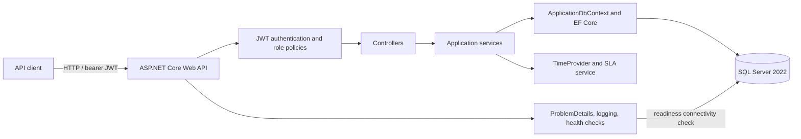
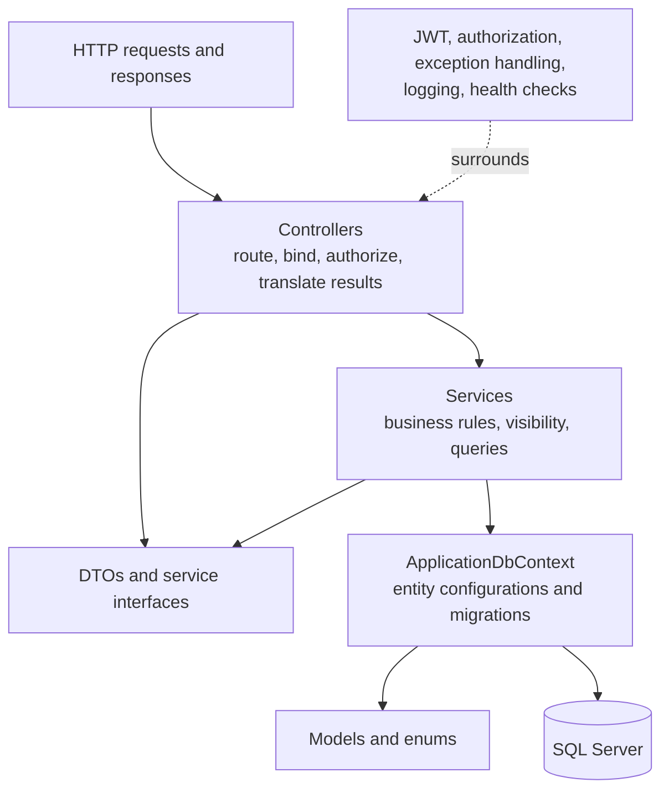
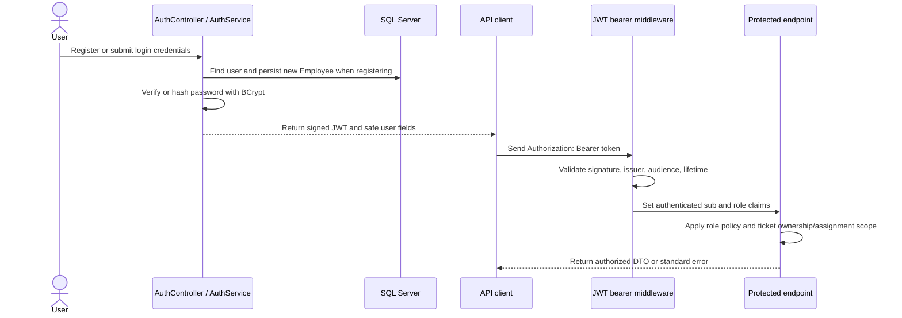
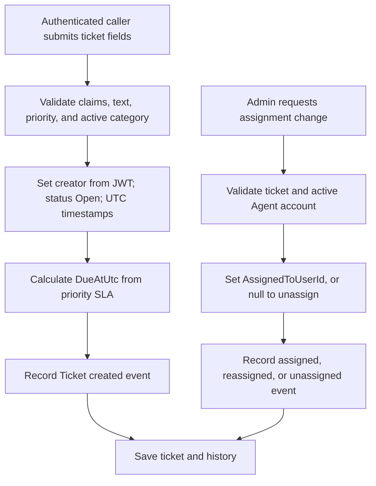
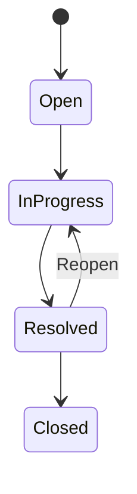
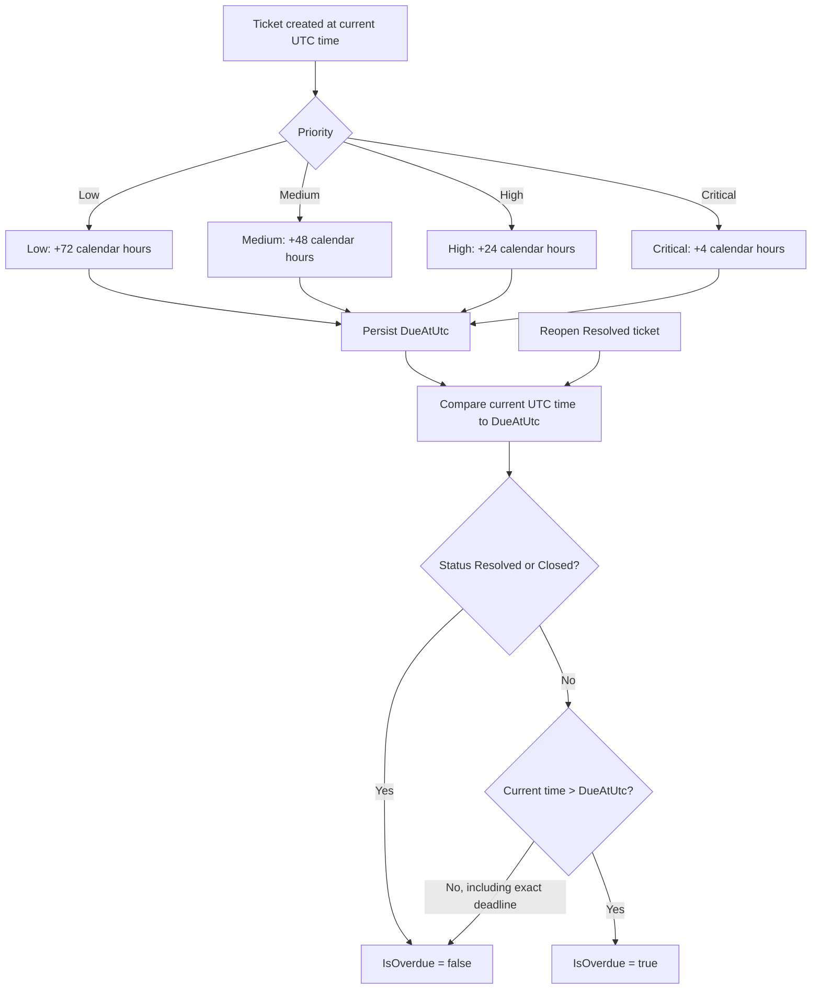
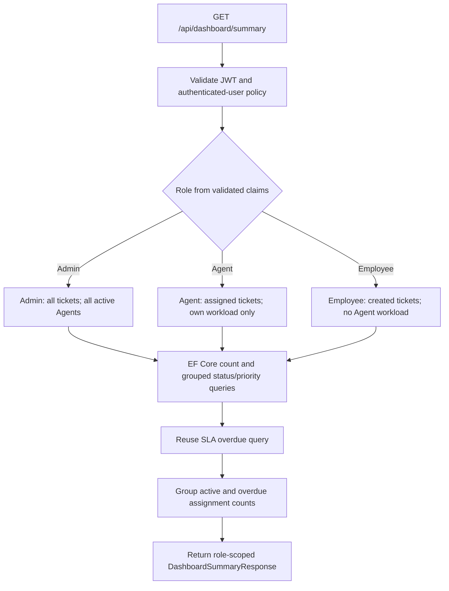

# Architecture and workflows

These diagrams describe the current HelpDeskPro implementation. The API is a single ASP.NET Core application; the diagram does not imply separately deployed services.

## 1. High-level system architecture

## 2. Layered application architecture

## 3. Authentication and authorization flow

Registration creates Employee accounts only. JWTs use HMAC-SHA256 and are validated for signing key, issuer, audience, and lifetime before protected actions run.

## 4. Ticket creation and assignment flow

Assignment is Admin-only. Assignment history is created only when the assigned Agent actually changes.

## 5. Ticket status workflow

Other transitions are rejected. Admins may update any ticket; an Agent may update only a ticket assigned to that Agent. A successful transition updates `UpdatedAtUtc` and adds a `TicketHistory` record. Employees cannot change status.

## 6. SLA deadline and overdue calculation

Priority changes recalculate the deadline. Edits to unrelated fields and reopening a ticket do not reset it. All comparisons use UTC; the deadline is exceeded strictly after the exact due time.

## 7. Dashboard request flow

Dashboard ticket totals and status/priority counts are aggregated in EF Core queries. Admin workloads include active Agent accounts; Agent workloads include only the caller; Employee responses contain no Agent workload records.
