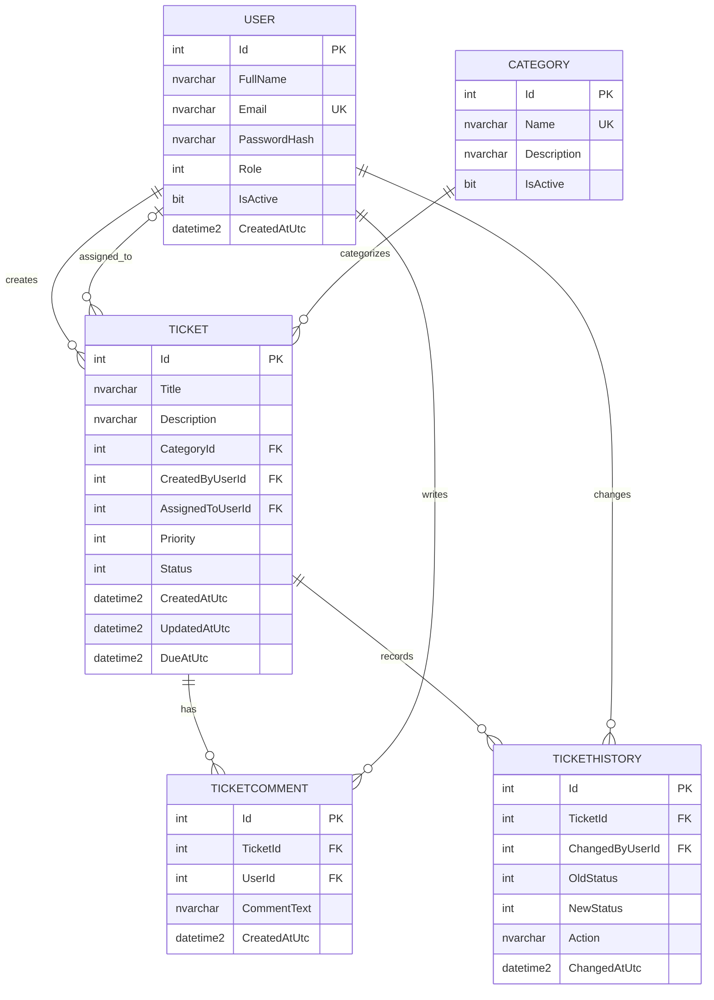

# Database documentation

HelpDeskPro uses EF Core 10 with SQL Server. `ApplicationDbContext` exposes `Users`, `Categories`, `Tickets`, `TicketHistories`, and `TicketComments`; entity mappings are in `Data/Configurations`.

## Entity relationship diagram

`Ticket.AssignedToUserId`, `Ticket.DueAtUtc`, `TicketHistory.OldStatus`, and `TicketHistory.NewStatus` are nullable. The `USER o|--o{ TICKET` relationship represents the optional assigned Agent; each ticket still has exactly one creator. All other foreign keys are required.

## Fields and constraints

| Entity | Actual fields | Mapping constraints |
|---|---|---|
| `User` | `Id`, `FullName`, `Email`, `PasswordHash`, `Role`, `IsActive`, `CreatedAtUtc` | Full name 200 characters; email 256; hash 500; unique email. |
| `Category` | `Id`, `Name`, `Description`, `IsActive` | Name 100 characters; description 1000; unique name. |
| `Ticket` | `Id`, `Title`, `Description`, `CategoryId`, `CreatedByUserId`, nullable `AssignedToUserId`, `Priority`, `Status`, `CreatedAtUtc`, `UpdatedAtUtc`, nullable `DueAtUtc` | Title 200; description 4000; `datetime2` UTC timestamps. Priority and status are required. |
| `TicketComment` | `Id`, `TicketId`, `UserId`, `CommentText`, `CreatedAtUtc` | Comment text 4000; `datetime2` timestamp. |
| `TicketHistory` | `Id`, `TicketId`, `ChangedByUserId`, nullable `OldStatus`, nullable `NewStatus`, `Action`, `ChangedAtUtc` | Action 1000; status values are nullable; `datetime2` timestamp. |

The enum columns `User.Role`, `Ticket.Priority`, `Ticket.Status`, `TicketHistory.OldStatus`, and `TicketHistory.NewStatus` are stored as integers by EF Core. API JSON uses camel-case enum names.

Foreign-key delete behavior is `Restrict` for Category-to-Ticket, User-to-created/assigned Ticket, Ticket-to-Comment/History, and User-to-Comment/History relationships. This prevents SQL Server cascade-delete paths and means related records can block ticket deletion.

The Category configuration seeds stable IDs 2–6 for Hardware, Software, Network, Access Management, and Other. The `SeedDefaultCategories` migration checks existing IDs/names before inserting and does not delete category records on rollback.

## Indexes

| Table | Indexed columns | Unique | Purpose in current mapping |
|---|---|---:|---|
| `Users` | `Email` | Yes | Prevent duplicate normalized account emails. |
| `Categories` | `Name` | Yes | Prevent duplicate category names. |
| `Tickets` | `CategoryId` | No | Ticket/category relationship lookup. |
| `Tickets` | `CreatedByUserId` | No | Creator-scoped ticket lookup. |
| `Tickets` | `AssignedToUserId` | No | Assignment-scoped lookup. |
| `Tickets` | `(Status, Priority)` | No | Status/priority filters and grouping. |
| `Tickets` | `CreatedAtUtc` | No | Default created-time ordering. |
| `TicketComments` | `(TicketId, CreatedAtUtc)` | No | Ordered comments for a ticket. |
| `TicketComments` | `UserId` | No | Comment-author relationship lookup. |
| `TicketHistories` | `(TicketId, ChangedAtUtc)` | No | Ordered history for a ticket. |
| `TicketHistories` | `ChangedByUserId` | No | History-actor relationship lookup. |

These are the indexes declared by EF configurations and represented in the checked-in migrations; this documentation does not claim measured query-performance gains.

## Migrations

The checked-in migrations are:

1. `20261121062414_InitialCreate`
2. `20261121073636_SeedDefaultCategories`

The model snapshot is `ApplicationDbContextModelSnapshot.cs`. Apply migrations with the commands in the [README setup section](../README.md#apply-the-existing-ef-core-migrations). The application does not migrate the database automatically during startup.
